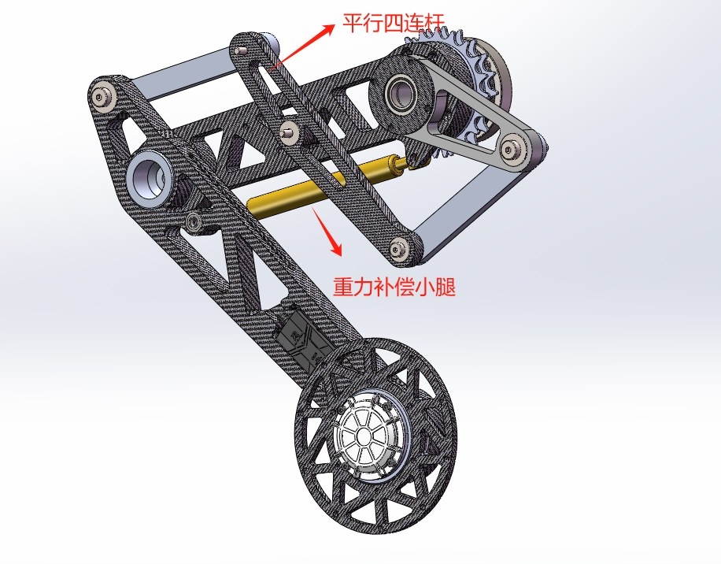

轮腿机器人在机械上的多数问题，在选型阶段就已经决定。下面按腿部构型、车身尺寸、轮径与电机四个维度给出取值依据。

## 常见的腿部构型

| 构型 | 特点 |
| --- | --- |
| 三连杆串联腿（Ascento） | 拓扑优化结构，轻 |
| 双驱动串联腿 | 交叉腿设计，保证机体水平 |
| 四连杆并联腿 | 平行连杆 + 气弹簧 |
| 五连杆并联腿 | 两个电机都放在髋部，腿部惯量小 |

我们用的是五连杆并联腿。之后还想加一个髋关节 roll 自由度，让机体能侧向调平。

## 选型建议

- **车身做短**。短车身好调，这是调试阶段最先吃到好处的取舍。
- **车宽看电机**。先看电机尺寸，以及电机放在大腿还是小腿。
- **小腿可以长一点**。小腿长更容易上台阶，不容易卡墙或卡在地面死区；站到最高时遇到扰动可以收腿。
- **并联腿量力而行**。队伍没有对应的加工能力时，不建议直接上并联腿，调试成本会成倍增加。

## 大轮还是小轮

| | 大轮 | 小轮 |
| --- | --- | --- |
| 打滑 | 有优势 | 容易打滑，需要额外补偿 |
| 通过性 | 强 | 较差 |
| 功率 | 损耗大，功率硬件可能扛不住 | 功率利用最大化 |

我的建议是小轮，配 3508 电机改减速箱（1:16）。1:14 的背隙有点大，也可能是加工精度不够，减速箱零件最好外包线切割保证精度。小轮的通过性可以用 MPC 等算法来弥补，效果很明显（见 [在单片机上跑 MPC](../mpc-on-mcu/index.md)）。

## 电机

队里用的是达妙 8009。想把车做小，可以考虑宇树 Go1 关节电机或达妙 8006；更小还有 4310。

## 理论与工具

- 设计基础：齿轮、连杆、轴承设计，以及重力自适应。
- 分析工具：Adams 做动力学与受力分析，SolidWorks / Ansys 做有限元。

<figure markdown="span">
  { loading=lazy }
  <figcaption>第二代腿部构型：平行四连杆 + 重力补偿小腿</figcaption>
</figure>
