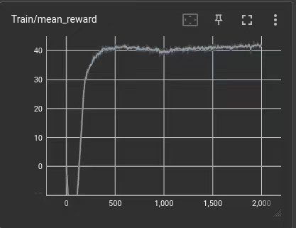

训练双足行走策略时，TensorBoard 里会有几十条曲线。下面按奖励项、Loss、学习率三类整理每条曲线该怎么看。

## 为什么是 PPO

双足运动控制里 PPO 几乎是默认选择。它的裁剪机制限制了每次策略更新的幅度，训练前期站不稳、中期学迈步、后期调平滑，样本分布变化很大，PPO 不容易被异常样本带偏。它是 on-policy 算法，数据用完即弃，正好适配 Isaac Gym 这类单卡并行几千个环境的 GPU 仿真。

## 奖励项曲线

| 曲线 | 含义 | 怎么看 |
| --- | --- | --- |
| `rew_action_smoothness` | 动作平滑度 | 计算动作一阶或二阶差分的平方和，抑制高频振动。训练初期波动，之后逐渐上升，稳定在一个接近 0 的小值（走路必然有动作变化，不会正好为 0） |
| `rew_base_acc` | 基座加速度惩罚 | 基座在世界系下线加速度的平方和 |
| `rew_base_height` | 基座高度 | 防止蹲着走或趴着爬 |
| `rew_default_joint_pos` | 默认关节位置 | 约束机器人形态 |
| `rew_dof_acc` | 关节加速度惩罚 | 保护硬件，也是仿真能迁移到实机的关键 |
| `rew_feet_air_time` | 足部滞空时间 | 鼓励迈步，避免拖着脚走 |
| `rew_feet_clearance` | 抬脚高度 | 只作用于摆动相，跟踪目标轨迹或约束最小高度 |
| `rew_feet_contact_forces` | 足部接触力惩罚 | 衡量踩地有多重 |
| `rew_feet_contact_number` | 触地数量 | 约束步态节奏 |
| `rew_feet_distance` | 双脚相对位置 | 防止两脚过近或交叉 |
| `rew_foot_slip` | 足部打滑惩罚 | 支撑脚不该滑动 |

## Loss 曲线

**value_function（价值函数损失）**

- 下降：通常是好事，说明 Critic 对分数的预测越来越准。
- 突然暴涨：可能是学习率太高、网络参数炸了；也可能是机器人突然学会了新技能（比如从只会站到会跑），奖励骤增而 Critic 还没跟上。后一种情况 Loss 随后会再次下降。
- 一直很高：环境随机性太强，或者价值网络拟合能力不够。
- 接近 0：复杂物理仿真里很少见，可能任务太简单或者过拟合。

**symm（对称性损失）**

应该迅速下降并稳定在很低的值，说明左右两侧的经验能互相复用。如果一直很高，机器人可能练成了「麒麟臂」或「瘸腿」，左右控制逻辑不一致。

**surrogate（代理损失）**

最健康的状态是平稳震荡。长期等于 0 说明梯度消失、停止学习；突然变成巨大的正负数说明数值不稳定，训练可能崩了。

## 学习率曲线

- **上下震荡**：最常见，说明自适应机制在根据 KL 散度动态调整。
- **一路下跌到接近 0**：要警惕。可能已经收敛，也可能策略更新差异过大（KL 爆炸），系统在拼命降学习率止损，通常伴随奖励不再增长。
- **一条水平线**：配置里用了固定学习率，属于正常设置。

## 一次调参记录

一次训练中机器人学会了「站着不动」来避免扣分。下面是把它调到「走得准」的改动：

1. **PPO 学习率**：从 1e-5 提高到 1e-3。
2. **PD 刚度**：从 100 降到 40，防止高频震荡。
3. **控制频率**：decimation 设为 4（250 Hz），让控制更细腻。
4. **奖励平衡**：删除 `stand_still`（权重设为 0），防止机器人为了偷懒不走；收紧 `tracking_sigma` 到 0.25，逼它走得准；提高 `feet_air_time` 和 `tracking_lin_vel` 的权重。

<figure markdown="span">
  { loading=lazy }
  <figcaption>轮腿项目的 mean_reward：快速爬升后进入平台震荡</figcaption>
</figure>
