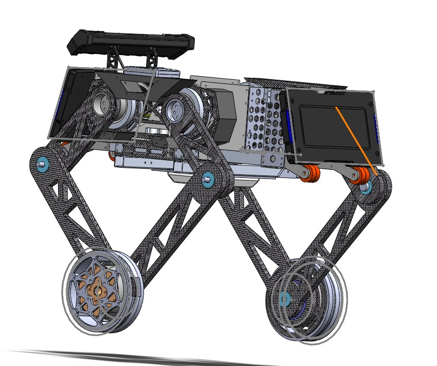
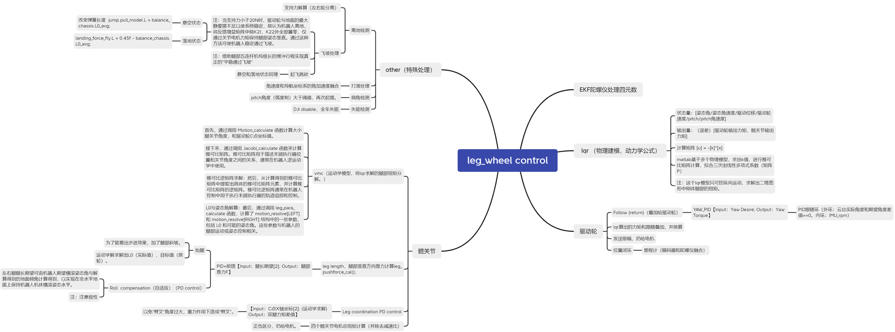

轮腿平衡步兵的运动控制设计：从二级倒立摆建模、五连杆力矩解算，到打滑与离地的实机处理。项目的整体介绍见 [五连杆轮腿平衡机器人](../../projects/02-wheel-legged-balance/index.md)。

<figure markdown="span">
  { loading=lazy }
  <figcaption>轮腿平衡步兵三维模型</figcaption>
</figure>

## 先理论，再上车

我给自己定的路线是每一步都先推导、再在简化平台上验证，最后才合到整车上：

1. 推导轮部 PID 控制，在「小板凳」上做 PID 实践
2. 用经典力学和拉格朗日方程推导物理模型
3. 推导轮部 LQR，再回到小板凳上验证
4. 推导腿部 VMC 控制
5. 轮式 LQR 加上 VMC 腿部控制，合到整车

建模上参考了上海交大的平行杆单腿构型：LQR 部分把腿简化成单杆，算出纵向运动需要的轮毂和关节电机扭矩；VMC 结合纵向和竖直方向的力与运动学解，通过雅可比矩阵把工作空间的力映射成关节空间的扭矩。腿按五连杆解算就行，不影响 LQR。

<figure markdown="span">
  { loading=lazy }
  <figcaption>控制框架思维导图</figcaption>
</figure>

## 时间线

10.28 — 11.15<strong>画车、调车</strong>

小轮腿出图、装配，开始调底层：MIT 电机通信、9025 驱动和上位机、轮毂与关节电机极性。

11.15 — 1.7<strong>带腿的正常运动</strong>

站起来、加转向环，DR16 遥控整合进底盘逻辑。

1.7 — 1.9<strong>丝滑的平地运动</strong>

平地运动调顺，开始处理各种异常工况。

1.9 — 1.12<strong>离地处理</strong>

根据地面支持力做逻辑判断和特殊处理，提高鲁棒性。

1.12 — 1.16<strong>打滑、悬空、起跳、着陆、飞坡</strong>

不带云台的底盘完成打滑处理、悬空检测、起跳与着陆，能飞坡。

1.16 — 1.21<strong>整车功能</strong>

调头、发射、自瞄、小陀螺、键鼠操作。

1.21 — 1.24<strong>中期视频</strong>

录制中期考核视频，寒假后做全车优化。

## 那些底层细节

清单里最不起眼、但最费时间的往往是这些：

- **电机极性**：轮毂电机和关节电机的极性逐个确认，关节电机统一约定「正方向为顺时针」。
- **零点**：用 Flash 记录关节角度，顺便检查电机零点的精度。
- **「发癫」保护**：电流持续过大（计数到 50）就置位保护标志，避免电机失控。
- **板间通信**：底盘向云台发送速度 `x`、偏航角速度 `w`，以及腿高、起跳、超级电容开关、左右腿通道等状态。

## 状态机与遥控映射

控制状态分三组：

| 组 | 取值 |
| --- | --- |
| 控制 | 0 失能 · 1 正常运动 |
| 腿高 | 0 低 · 1 正常 · 3 高 |
| 特殊检测 | 0 收腿 · 1 起跳 · 2 飞坡 |

DR16 遥控器两个拨杆组合出不同模式（以单底盘调试为例）：

| 拨杆 | 模式 |
| --- | --- |
| 中 · 中 | 正常运动，拨轮控制抬腿 |
| 中 · 上 | 正常运动，拨轮控制小陀螺 |
| 中 · 下 | 正常运动，拨轮触发起跳 |
| 上 · 上 | 键鼠模式（PC） |
| 上 · 下 | 比赛模式：右摇杆控制速度与转向，左摇杆控制抬腿和双腿同步；拨轮向上起跳（需两腿同高），向下两腿同高 |
| 下 · 下 | 失能 |

整车模式在此基础上加入摩擦轮、单发 / 连发和打符。

## 代码结构

底盘固件按功能拆成独立模块：LQR、VMC、腿长控制、双腿协调、转向环、跳跃、打滑处理和底盘滤波在应用层；IMU（CH100 + Mahony）、CAN、电调协议和裁判系统在板级。调参时用匿名上位机实时看曲线。
