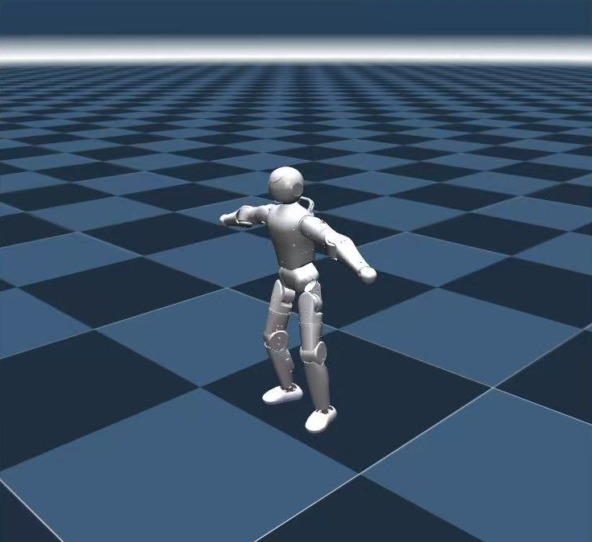
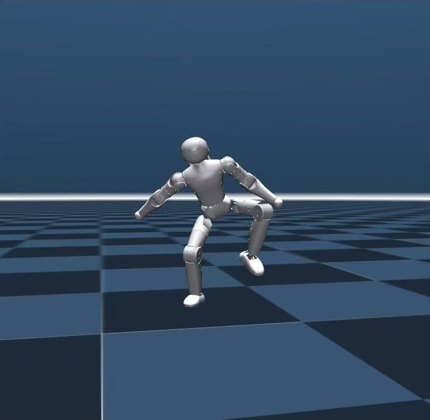

<figure class="zr-video">
  <video src="v01_humanoid_rl.mp4" autoplay loop muted playsinline controls preload="metadata"></video>
  <figcaption>双足机器人在随机崎岖地形上的行走策略（Isaac Gym 训练）</figcaption>
</figure>

| 角色 | 关键技术 |
| --- | --- |
| 人形机器人算法实习生 | Isaac Gym · rsl_rl · AMP · MuJoCo · Jetson Orin · ONNX Runtime |

两段人形机器人公司实习的工作合集：在 NVIDIA Isaac Gym / Isaac Sim 中大规模并行训练双足行走策略，用动捕数据和 AMP 让动作更自然，上机前在 MuJoCo 里做 Sim2Sim 验证，最终部署到 Jetson Orin 实机。

## 大规模并行仿真训练

- 基于 NVIDIA Isaac Sim / Gym 搭建自研人形机器人验证环境。
- 设计课程学习，让策略由易到难逐步收敛。
- 改造 rsl_rl、legged_gym 开源框架的多目标奖励函数，从四足、双足通用改为双足专用；用门控耦合机制计算关键奖励项，提高学习效率。

训练曲线怎么读、奖励怎么调，单独写了一篇：[TensorBoard 曲线怎么读、PPO 怎么调](../../notes/tensorboard-ppo/index.md)。

## 动捕重定向与 AMP

- 将开源动捕数据集 LaFAN1 映射到机器人关节，用逆运动学（IK）约束解决自由度与尺寸不一致的问题。
- 用 AMP（对抗运动先验）把没有参考信号的强化学习，转化为对真实运动分布的模仿，实现高难度动作的零样本泛化。
- 在消费级人形机器人公司负责动捕数据到小型人形机器人的关节姿态映射，基于 SQP 最优求解器求解最优关节角，支撑 BeyondMimic 仿生模仿算法落地。

{ loading=lazy }
{ loading=lazy }

## Sim2Sim 与 Sim2Real 部署

- 上机前先在 MuJoCo 中做 Sim2Sim 验证，严格对齐底层观测空间：传感器通信延迟补偿、IMU 滤波噪声对齐、状态估计误差模拟。
- 针对踝关节并联机构：逆解采用并联结构数值解，正解用牛顿迭代求解，并用雅可比矩阵精确映射目标力与速度。
- 训练中加入域随机化，并加大动作变化率和加速度的惩罚权重，让策略输出更平滑。
- 在 NVIDIA Jetson Orin 上搭建本地编译的 C++ 推理框架，通过 ONNX Runtime 推理，实现上层策略与单片机 PD 控制解耦，显著缩小 Sim2Real 差距。

## 延伸研究：MPC + WBC

基于 OCS2 与 ros-control，用质心动力学模型做非线性模型预测控制（NMPC）与全身控制（WBC）。在 legged_control、hunter_bipedal_control、livelybot_dynamic_control 等开源项目的基础上改进约束设计，并在 Gazebo 中完成仿真验证。详见 [OCS2 + ros-control 上手笔记](../../notes/ocs2-mpc-wbc/index.md)。
