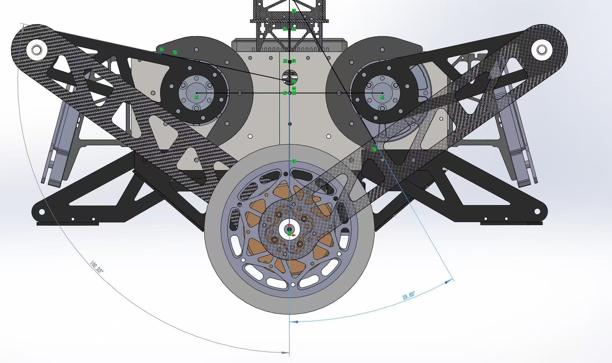
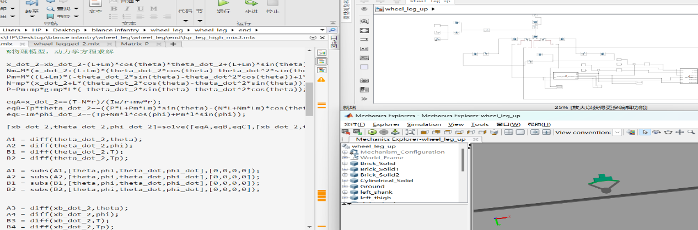
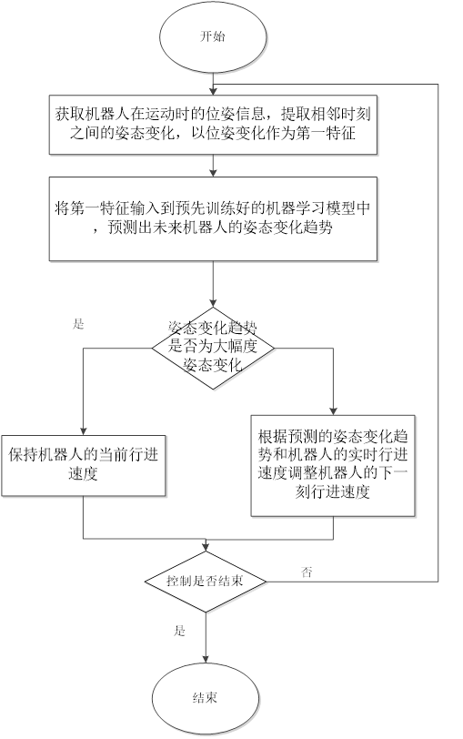
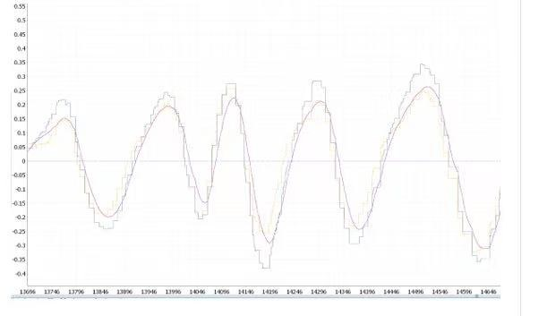
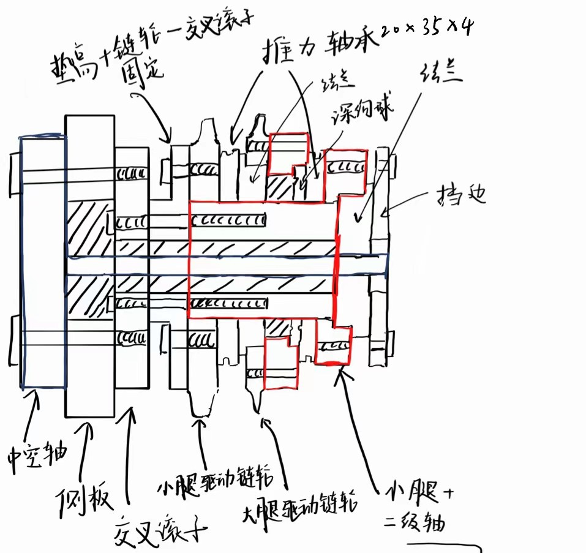

<figure class="zr-video">
  <video src="v02_real_drive.mp4" autoplay loop muted playsinline controls preload="metadata"></video>
  <figcaption>实机综合运动：在训练场地上越过坡道</figcaption>
</figure>

| 角色 | 关键技术 |
| --- | --- |
| 运动控制算法负责人 | LQR · VMC · LSTM · 卡尔曼滤波 · KNN · Simscape · Webots |

RoboMaster 轮腿式平衡步兵的运动控制。从二级倒立摆动力学建模、LQR 平衡控制，到 VMC 五连杆力矩解算，再到打滑、离地等真实场地问题，让机器人在赛场上稳定运行。完整的开发过程写在了 [轮腿开发日志](../../notes/wheel-leg-devlog/index.md) 里。

## 结构与运动学

<div class="zr-gallery zr-gallery--2" markdown>

{ loading=lazy }
{ loading=lazy }

</div>

## 动力学建模与 LQR 平衡

- 把机器人简化为二级倒立摆，用拉格朗日方程推导动力学模型。
- 求状态方程的雅可比矩阵，在平衡点附近对非线性模型线性化，设计 LQR 控制器实现自主平衡。
- 用 VMC（虚拟模型控制）把髋关节等效力矩转换成五连杆两个关节电机的力矩，实现轮与腿的耦合控制。

<figure markdown="span">
  { loading=lazy }
  <figcaption>控制框架思维导图</figcaption>
</figure>

<div class="zr-gallery zr-gallery--3" style="--zr-tpl: minmax(0, 50fr) minmax(0, 25fr) minmax(0, 25fr)" markdown>

{ loading=lazy }
{ loading=lazy }
{ loading=lazy }

</div>

<figure class="zr-video">
  <video src="v02_webots.mp4" loop muted playsinline controls preload="metadata"></video>
  <figcaption>Webots 算法验证</figcaption>
</figure>

## 真实场地的问题

- **姿态预测**：用 LSTM 网络预测机器人未来的姿态变化趋势，提前识别失稳风险。
- **打滑处理**：真实地面会打滑，用简化的卡尔曼滤波融合角速度与导航坐标系下的角加速度，把速度映射到相对惯性空间。
- **离地检测**：用逆雅可比矩阵求出地面支持力，再用 KNN 最近邻算法计算触地置信度，提高离地判断的准确度。

<figure class="zr-video">
  <video src="v02_airborne.mp4" loop muted playsinline controls preload="metadata"></video>
  <figcaption>离地处理：从台阶跳下后平稳落地</figcaption>
</figure>

<div class="zr-gallery zr-gallery--2 zr-gallery--raw">
<video src="v02_slip.mp4" controls muted loop playsinline preload="metadata"></video>
<video src="v02_field.mp4" controls muted loop playsinline preload="metadata"></video>
</div>

## 固件结构

底盘固件按功能拆成独立模块，应用层与板级驱动分开：

```text
APP/
├── LQR/            LQR 控制与增益参数
├── VMC/            五连杆虚拟模型控制
├── Leg_Length/     腿长控制
├── Leg_Harmony/    双腿协调
├── Yaw_pid/        转向环
├── jump/           起跳与着陆
├── sliphandle/     打滑处理
├── chassis_filter/ 底盘状态滤波
└── unitree_motor/  关节电机驱动
BSP/
├── CH100/          IMU
├── algorithm/      Mahony 姿态解算
├── can_receive/    CAN 收发
├── dshot/          轮毂电调协议
└── judge/          裁判系统
```

## 新构型与毕业设计

在第一代基础上重新设计腿部：采用平行四连杆加重力补偿小腿，并完成二级轴的剖面设计。

<div class="zr-gallery zr-gallery--2" markdown>

{ loading=lazy }
{ loading=lazy }

</div>

## 成果

- 所在团队获 RoboMaster 全国赛二等奖、区域赛省级一等奖。
- 发明专利申请「一种轮腿式平衡机器人的控制方法及系统」，第一发明人。
