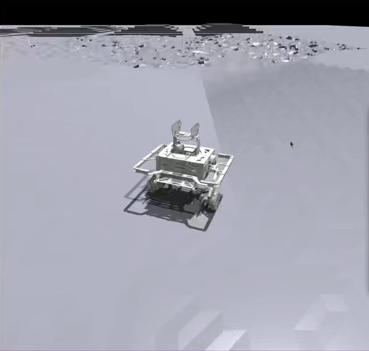

<figure class="zr-video">
  <video src="v03_ppo_isaacgym.mp4" autoplay loop muted playsinline controls preload="metadata"></video>
  <figcaption>Isaac Gym 中训练 5000 轮后的策略：在随机起伏地形上行驶</figcaption>
</figure>

| 角色 | 关键技术 |
| --- | --- |
| 奖励设计与策略训练 | PPO · Teacher-Student · Isaac Gym |

在经典控制之外，用强化学习控制轮腿机器人。机器人模型采用哈尔滨工程大学开源的 URDF，在 Isaac Gym 中设计奖励函数，用 Teacher-Student 框架和 PPO 训练策略，再蒸馏成轻量的 MLP 网络。

## 训练方法

- **指令跟踪**：策略同时跟踪线速度、角速度和腿高三类指令，并据此设计奖励函数。
- **Teacher-Student**：Teacher 在仿真中利用特权信息学习，Student 只使用实机能拿到的观测，通过蒸馏模仿 Teacher 的行为。
- **轻量部署**：把策略蒸馏为 MLP 网络，在资源受限的嵌入式 MCU 上完成闭环推理。

{ loading=lazy }
{ loading=lazy }

## 结果

- 训练 5000 轮后，策略能在随机起伏地形上稳定跟踪速度、角速度和腿高指令。
- MLP 网络在嵌入式 MCU 上闭环运行，覆盖了传统控制难以兼顾的特殊工况。
