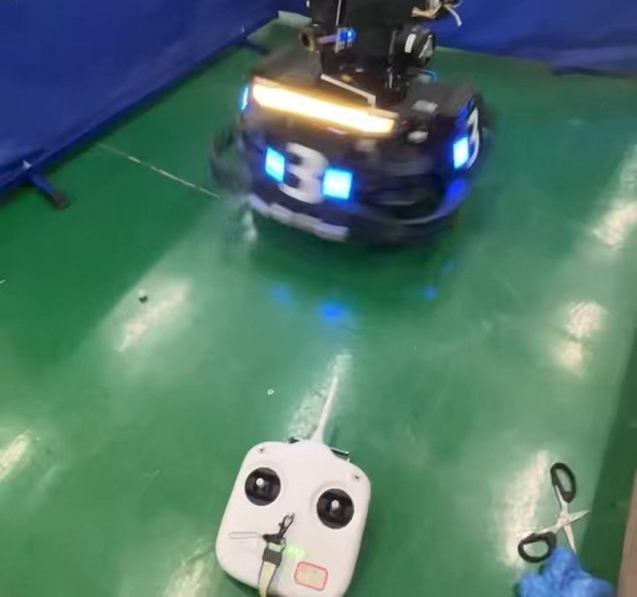
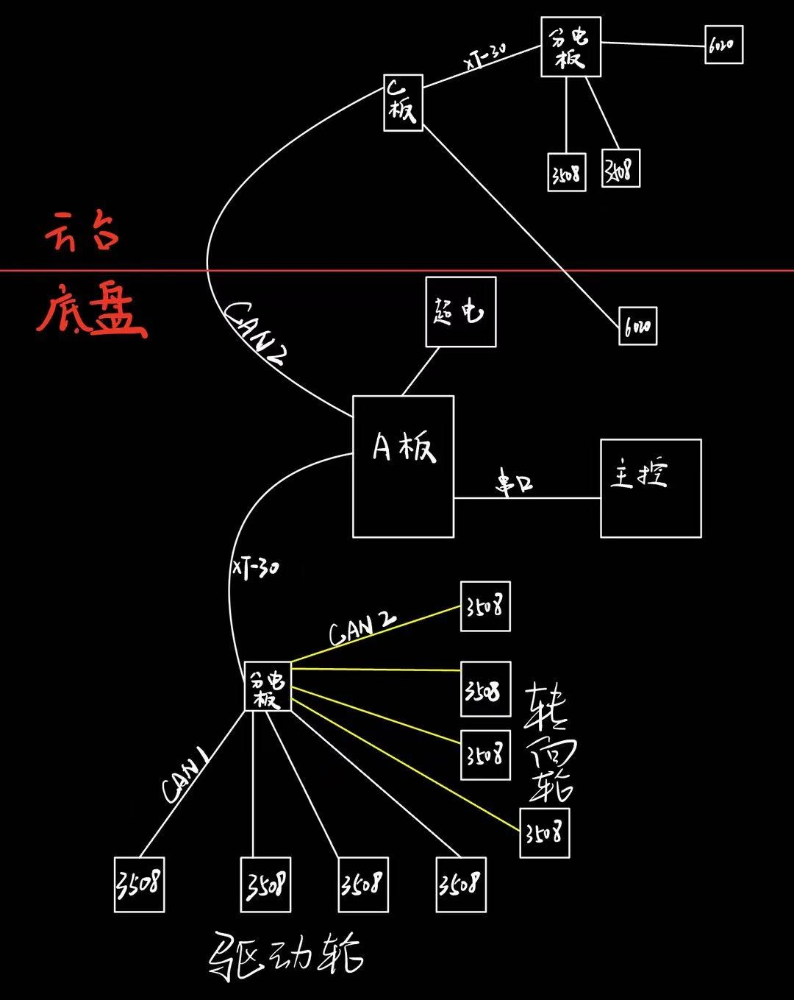
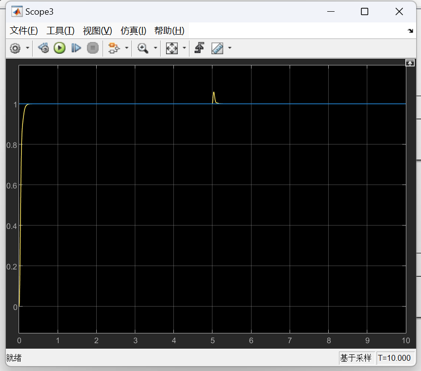

<video src="v04_swerve_spin.mp4" autoplay muted loop playsinline preload="metadata"></video>

| 角色 | 关键技术 |
| --- | --- |
| 嵌入式开发 | STM32F407 · 串级 PID · LADRC · Mahony · EKF · CAN · UART |

RoboMaster 全向运动舵轮步兵的电控系统。基于 STM32F407IGH6 实现云台与舵轮底盘的串级 PID 跟随控制；底盘用最小劣弧解算舵向，实现全向运动；云台采用二阶 LADRC 控制。

## 控制与解算

- **舵轮全向运动**：舵向采用最小劣弧解算，每个舵轮以最小转角转到目标方向。
- **云台姿态**：通过 SPI 读取 BMI088 六轴数据，用 Mahony 算法融合解算四元数，再结合卡方检验和扩展卡尔曼滤波（EKF）提高鲁棒性。
- **云台控制**：二阶 LADRC 以 PD 控制器为基础，加入跟踪微分器（TD）对输入信号滤波，把阶跃指令变成平滑的过渡曲线，平稳靠近目标、不超调。
- **通信**：电机全部采用 CAN 总线；与视觉上位机通过 UART 通信，接收控制数据实现自主跟踪。

## 设计过程

{ loading=lazy }
{ loading=lazy }

