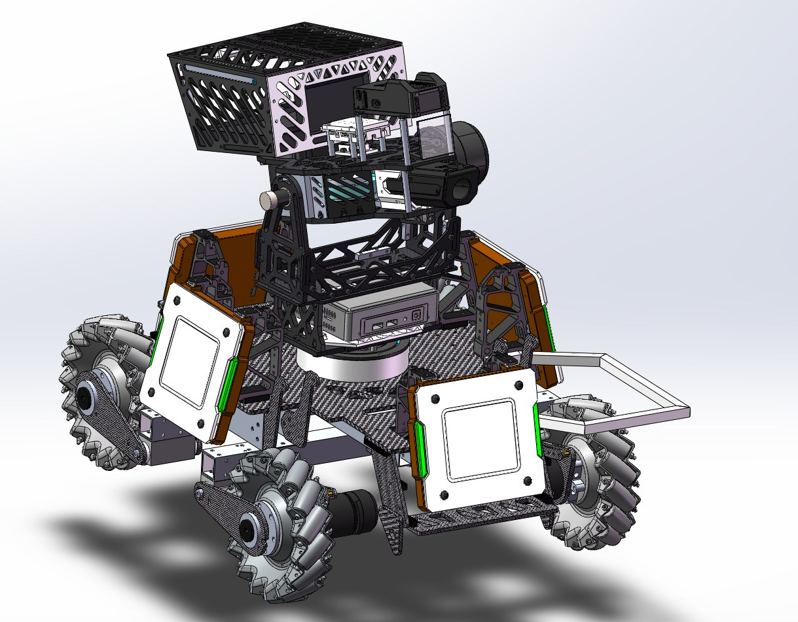
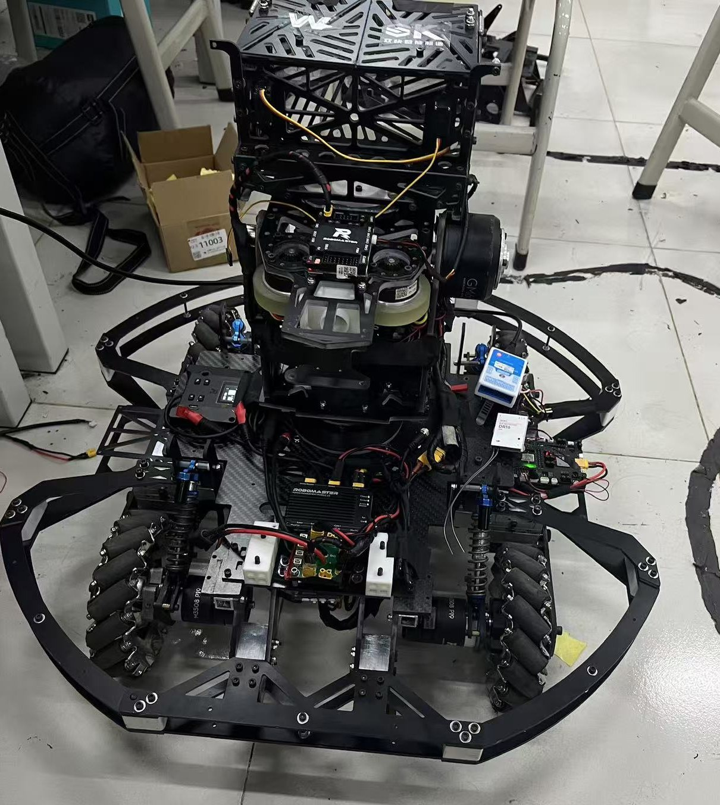
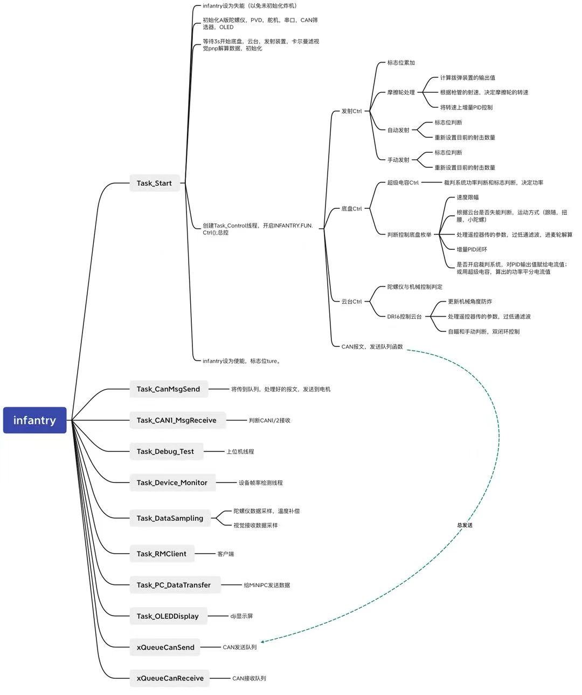

<div class="zr-gallery zr-gallery--2 zr-gallery--raw" style="--zr-tpl: minmax(0, 33fr) minmax(0, 66fr)">
<video src="v05_mecanum_follow.mp4" controls muted loop playsinline preload="metadata"></video>

</div>

| 角色 | 关键技术 |
| --- | --- |
| 嵌入式负责人 | STM32F407 · FOC · 串级 PID · Mahony · EKF · CAN · UART |

RoboMaster 无刷 FOC 驱动的麦轮步兵机器人。基于 STM32F407IGH6 实现云台与麦轮底盘的串级 PID 跟随闭环，并为视觉上位机预留控制接口，实现自主跟踪与精确打击。

## 嵌入式系统

- **串级 PID**：云台与底盘采用串级 PID 闭环，实现底盘跟随云台。
- **姿态解算**：SPI 读取 BMI088 六轴数据，Mahony 算法融合解算四元数得到云台位姿，用卡方检验和扩展卡尔曼滤波提高鲁棒性。
- **视觉集成**：开发 UART 串口协议与视觉上位机通信，接收控制数据实现自主跟踪与打击。
- **总线**：电机全部采用 CAN 总线通信。

## 固件结构

步兵固件分为算法、应用、板级三层：

```text
Algorithm/  PID · 模糊 PID · 卡尔曼滤波 · AHRS · 斜坡与抛物线规划 · CRC
Apps/       底盘控制 · 云台控制 · 发射控制 · 视觉控制 · 功率限制 · IMU 温漂补偿 · 设备监控
BSP/        CAN · ADC · Flash 参数存储 · 串口
```

## 结构与程序框架

<div class="zr-gallery zr-gallery--2" markdown>

{ loading=lazy }
{ loading=lazy }

</div>
