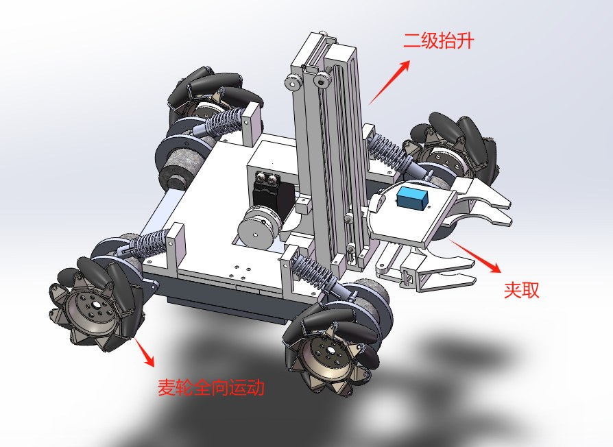
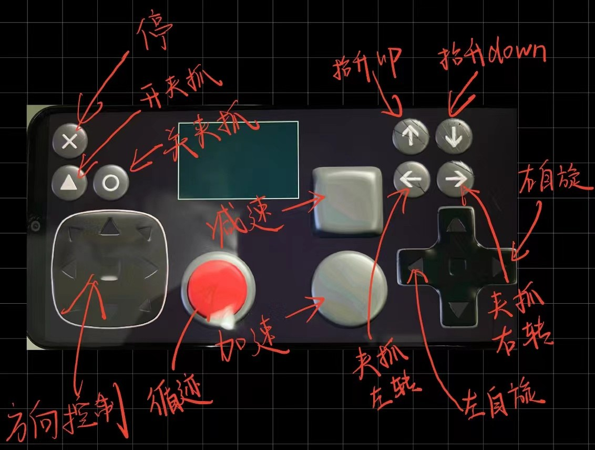
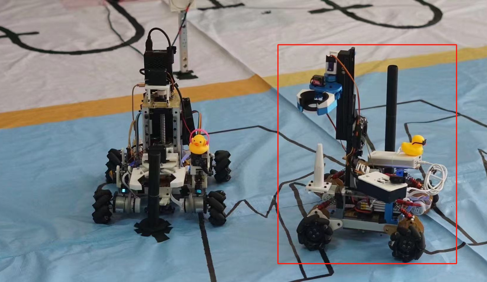
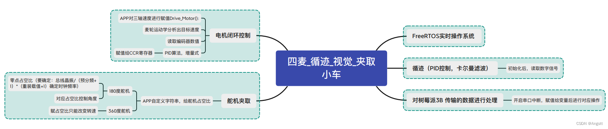

<figure class="zr-video">
  <video src="v06_gripper_car.mp4" autoplay loop muted playsinline controls preload="metadata"></video>
  <figcaption>循迹与夹取演示</figcaption>
</figure>

| 角色 | 关键技术 |
| --- | --- |
| 嵌入式开发 | STM32F4 · FreeRTOS · PID · 卡尔曼滤波 · 树莓派 3B · SolidWorks |

队内赛作品：基于 FreeRTOS 的四麦轮全向夹取小车。STM32F4 主控负责读取编码器、解析手机 APP 发来的 XYZ 三轴指令、用 PID 计算 PWM，并处理与树莓派 3B 之间的数据传输；基于 PID 与卡尔曼滤波的循迹策略通过检测循迹电平调整电机速度，实现自动循迹。

## 系统实现

- **电机闭环**：定时器读取编码器 CNT 计数，PID 算出 PWM 后写入电机控制结构体。
- **APP 控制**：把 APP 发来的字符串分解为 XYZ 三轴运动指令，APP 也能直接控制舵机夹爪。
- **循迹**：基于 PID 与卡尔曼滤波，根据循迹电平调整电机速度。
- **视觉协同**：处理树莓派 3B 传来的视觉数据，用于定位和夹取目标。
- **结构**：SolidWorks 建模，包含二级抬升、夹取机构和麦轮全向底盘。

{ loading=lazy }
{ loading=lazy }

<figure markdown="span">
  { loading=lazy }
  <figcaption>场地调试</figcaption>
</figure>

<figure markdown="span">
  { loading=lazy }
  <figcaption>程序框架思维导图</figcaption>
</figure>
