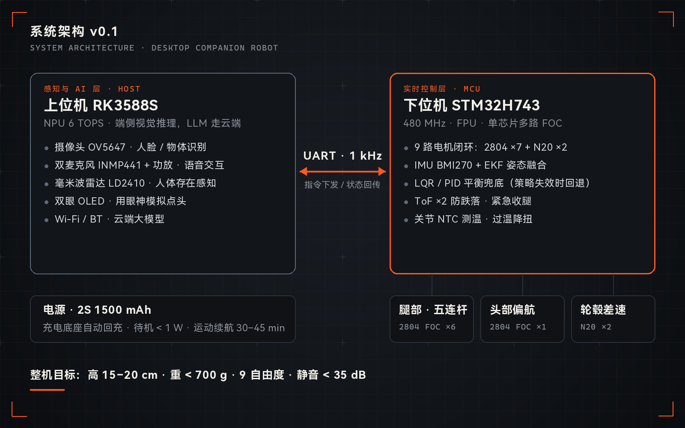

<figure markdown="span">
  { loading=lazy }
  <figcaption>系统架构 v0.1</figcaption>
</figure>

| 角色 | 关键技术 |
| --- | --- |
| 个人项目 · 系统设计 | RK3588S · STM32H743 · 2804 FOC · MuJoCo · EKF |

正在推进的个人项目：一台高 15–20 cm、重量小于 700 g 的桌面情感陪伴机器人。它不堆砌天气、音乐这类工具功能，而是专注「记得用户、理解行为、形成陪伴感」。目前处于硬件方案验证阶段。

## 整机定义

| 参数 | 目标 |
| --- | --- |
| 高度 | 15–20 cm |
| 重量 | 小于 700 g |
| 自由度 | 9（腿部 6 + 轮毂 2 + 头部偏航 1） |
| 电池 | 2S 1500 mAh，运动续航 30–45 min，配充电底座 |
| 噪音 | FOC 直驱云台电机，目标低于 35 dB |

## 关键设计决策

- **五连杆并联腿**：两个电机集中在髋部，腿部转动惯量小，强化学习更容易收敛。
- **取消头部俯仰电机**：用双眼 OLED 的眼神变化模拟点头，减重、降噪、降本。
- **N20 减速电机做轮毂**：比无刷轮毂成本低得多，差速转向足够用。
- **上下位机分层**：RK3588S 负责视觉与语音（大模型走云端），STM32H743 单芯片跑 9 路 FOC 与 EKF；强化学习策略失效时由 LQR / PID 兜底。
- **安全与热管理**：ToF 防跌落、关节 NTC 测温、过温降扭。

## 用户研究

整理了桌面 / 情感陪伴机器人的用户痛点与竞争格局，得出几条设计原则：

- 新鲜感消退是最大问题，长期记忆是建立真实情感连接的关键。
- 真正打动用户的是行为识别，而不只是情绪标签。
- 陪伴型和工具型产品的设计逻辑不同，不做功能堆砌。
- 摄像头和麦克风会带来隐私顾虑，人体存在感知优先用毫米波雷达，不需要摄像头常开。

## 路线图

1. **电机实测** 2804 电机的堵转扭矩、温升曲线、控制带宽，给出 Go / No-Go 结论。
2. **结构仿真** 五连杆单腿 URDF 导入 MuJoCo，验证足端工作空间与关节限位。
3. **AI 最小闭环** ESP32-S3 + 大模型 API + TTS 跑通最小对话闭环。
4. **驱动板** 设计 STM32H743 一驱二 FOC 验证板。
5. **可制造性** 与模具厂沟通，按注塑约束设计结构件。

